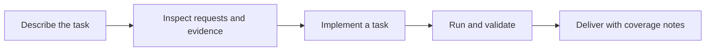

<picture>
  <source media="(prefers-color-scheme: dark)" srcset="docs/images/readme-hero-dark.svg">
  <source media="(prefers-color-scheme: light)" srcset="docs/images/readme-hero-light.svg">
  
</picture>

<div align="center">

# Spider Workbench

**Data collection and Web / JavaScript reverse engineering, with your coding Agent.**

Describe the task. Give your Agent one workspace to analyze, implement, validate and deliver.

[](https://github.com/hygge-pixel/spider-workbench/releases/tag/v0.1.10) [](docs/RUNTIME_COMPATIBILITY.md) [](docs/RUNTIME_COMPATIBILITY.md) [](LICENSE)

**[Download install ZIP](https://github.com/hygge-pixel/spider-workbench/releases/download/v0.1.10/spider-workbench-0.1.10-install.zip)** · **[Get started](#get-started)** · [User guide](docs/USER_GUIDE.md) · [中文](README.md)

</div>

---

## One workspace for methods, tools and evidence

Collection work often gets stuck between environment setup, request analysis, data checks and handoff. Spider Workbench brings project rules, 13 reusable Skills, browser tooling and a unified runner together, giving your Agent a consistent path and keeping the results inspectable.

<table>
<tr>
<td width="50%" valign="top">
<h3>01 · Start in plain language</h3>
<p>Open the workspace and send the deployment prompt. Your Agent checks the environment, installs isolated tools and connects MCP, reusing stages already completed.</p>
</td>
<td width="50%" valign="top">
<h3>02 · Connect analysis to collection</h3>
<p>Use evidence to choose request inspection, JavaScript analysis and local Python / Node replay. Add browser work where needed; reuse a verified protocol path.</p>
</td>
</tr>
<tr>
<td valign="top">
<h3>03 · Check outputs, keep evidence</h3>
<p>Declare fields, unique keys, counts and completion criteria. Keep normalized records, validation results and coverage notes for review and delivery.</p>
</td>
<td valign="top">
<h3>04 · Isolate tasks and tools</h3>
<p>Implement each task in experiments. The shared core uses Python's standard library; dependencies and browser profiles stay isolated. Registration is your choice.</p>
</td>
</tr>
</table>

## Get started

**1. Download** → **2. Open the folder in your coding Agent** → **3. Send the deployment prompt**

Download and extract the [v0.1.10 install ZIP](https://github.com/hygge-pixel/spider-workbench/releases/download/v0.1.10/spider-workbench-0.1.10-install.zip), then open the project folder as your Agent's workspace.

<details open>
<summary><strong>Copy to your Agent: deploy and verify this workspace</strong></summary>

> Read README.md, AGENTS.md and docs/INSTALL_WITH_AGENT.md, then deploy this workspace. Inspect and reuse stages already completed. Check and install the required runtimes and isolated tools. Download the latest Stable Chrome for Testing from Google's official source, configure the project's independent profile, Chrome/9222 and js-reverse MCP. Verify the offline demo, browser connection, actual MCP tool calls and full delivery verification. Preserve existing tasks and configuration, and report what passed and what remains. Routine reversible installation, builds and project configuration are authorized; proceed continuously.

</details>

Your Agent follows the [existing deployment work order](docs/INSTALL_WITH_AGENT.md). Preserve existing tasks, configuration and profiles; deployment results go to `outputs/deployment_acceptance.md`. Use a coding Agent with local filesystem, terminal and tool-configuration access. Bring your own Agent account.

Already deployed? [Start a task](#start-your-first-task). For an existing workspace, read the [migration and upgrade guide](docs/MIGRATION.md) before updating; do not overwrite tasks and configuration.

## From request to delivery



Collectors implement task-specific work and run through `spider.py run`. The runner checks fields, unique keys, counts and completion criteria. Choose methods and tools from current evidence; confirmed CAPTCHA saves progress and pauses execution. Capability registration is explicit, not an automatic collection step.

### Start your first task

After deployment, describe a task in the same workspace. For example:

> Collect public articles from these pages for the last seven days. Keep title, original text, author, publication time and source URL. Start with five samples, then expand to the agreed scope after confirmation. Deliver Excel and JSON, preserve progress, report omissions and do not register a capability automatically.

To see how validation works first, ask your Agent to run the included **three-record offline example**. No website account is needed:

```sh
python spider.py run experiments/example_local/collector.py --task experiments/example_local/task.example.json
```

Use your configured Python 3.11. The command checks fields, unique keys and counts for three synthetic records. In the run directory, `normalized.jsonl` contains data, `validation.json` records checks, and `collector_result.json` describes completion and coverage.

## What's included

| Component | Purpose |
| --- | --- |
| **13 reusable Skills** | Collection routing, request analysis, JS reverse engineering, parameter reproduction, AST transforms, environment patching and evidence debugging |
| **Browser and MCP tooling** | JSReverser MCP source integration, Playwright CDP diagnostics and independent browser configuration |
| **Unified task core** | Execution, timeouts, output validation, run comparison, explicit registration and proof management |
| **Maintenance and delivery** | Offline examples, maintained tests, CI, file manifests and separate source/install bundles |

Keep task implementations in `experiments/`, run data and evidence in `runs/`, and final deliverables in `outputs/`. Shared methods live in `skills/`; the runtime core lives in `spider_core/`. See the [architecture](docs/ARCHITECTURE.md).

## Compatibility and verification

Rule entrypoints cover **Codex, Claude Code, Gemini CLI, Cursor, GitHub Copilot, Windsurf, Cline, Roo Code, Kiro, OpenCode and TRAE**. `AGENTS.md` is canonical; DeepSeek Harness has a [dedicated adapter](docs/DEEPSEEK_HARNESS.md). An entrypoint is not proof that every host integration works: actual connections and permissions require host acceptance.

- **Runtime baseline:** Python 3.11.x and Node 24 LTS. Windows is the main acceptance platform for the full browser workflow.
- **Existing checks:** Windows / Ubuntu offline framework and packaging CI, plus MCP source builds. See [Actions](https://github.com/hygge-pixel/spider-workbench/actions) and [verification](docs/VERIFICATION.md).
- **Coverage limits:** offline tests do not prove live websites, every Agent host or a clean machine without programming tools. Full clean-machine acceptance remains pending. See the [compatibility matrix](docs/AGENT_COMPATIBILITY.md).

The initial workspace has no website collectors. Website adaptation, pagination, field meaning and completeness need task-specific validation; Excel, JSON and other final formats are implemented per task. Source bundles exclude historical customer data, credentials, browser profiles and personal Agent settings. Runtimes and browsers are installed on the target machine.

## Documentation

| Start and use | Build and maintain |
| --- | --- |
| [User guide](docs/USER_GUIDE.md) · [Agent deployment](docs/INSTALL_WITH_AGENT.md) | [Collector guide](docs/COLLECTOR_GUIDE.md) · [Architecture](docs/ARCHITECTURE.md) |
| [Browser and MCP](docs/BROWSER_MCP.md) · [Troubleshooting](docs/TROUBLESHOOTING.md) | [Data and evidence](docs/EVIDENCE.md) · [Tests and CI](docs/VERIFICATION.md) |
| [Skills](docs/框架与Skills说明.md) · [Runtime compatibility](docs/RUNTIME_COMPATIBILITY.md) | [Dependencies](docs/DEPENDENCIES.md) · [Contributing](CONTRIBUTING.md) |

---

**Downloads:** [Releases](https://github.com/hygge-pixel/spider-workbench/releases) contain an install ZIP, a full source ZIP and checksums. The install bundle excludes developer tests and runtime/browser binaries; the source bundle retains maintained suites. `main` is the development branch; the top download is pinned to a stable release.

Original contributions use [Apache-2.0](LICENSE). Third-party materials retain their original licenses; see [notices](THIRD_PARTY_NOTICES.md). [Security](SECURITY.md) · [Changelog](CHANGELOG.md)
