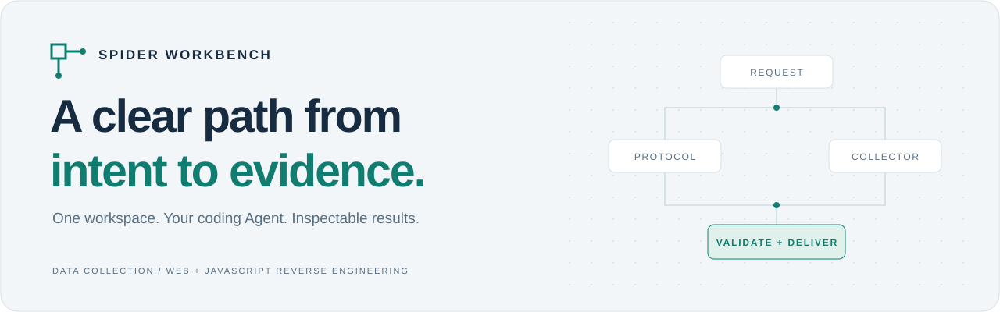
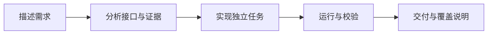

<picture>
  <source media="(prefers-color-scheme: dark)" srcset="docs/images/readme-hero-dark.svg">
  <source media="(prefers-color-scheme: light)" srcset="docs/images/readme-hero-light.svg">
  
</picture>

<div align="center">

# Spider Workbench

**面向 Coding Agent 的数据采集与 Web / JavaScript 逆向工作台**

描述任务，让 Agent 在同一工作区完成分析、实现、验证与交付。

[](https://github.com/hygge-pixel/spider-workbench/releases/tag/v0.1.11) [](docs/RUNTIME_COMPATIBILITY.md) [](docs/RUNTIME_COMPATIBILITY.md) [](LICENSE)

**[下载安装包](https://github.com/hygge-pixel/spider-workbench/releases/download/v0.1.11/spider-workbench-0.1.11-install.zip)** · **[快速开始](#快速开始)** · [用户指南](docs/USER_GUIDE.md) · [English](README.en.md)

</div>

---

## 把方法、工具和结果放在同一个工作区

采集任务常常卡在反复搭环境、分析接口、验证数据和交接结果之间。Spider Workbench 将项目规则、13 个通用 Skills、浏览器工具链和统一运行入口组织在一起，让 Agent 有路径可循，让结果有依据可查。

<table>
<tr>
<td width="50%" valign="top">
<h3>01 · 用自然语言开始</h3>
<p>打开项目、发送部署提示词。Agent 检查环境、安装隔离工具并接入 MCP，已经完成的部分继续复用。</p>
</td>
<td width="50%" valign="top">
<h3>02 · 让采集与逆向衔接</h3>
<p>按证据选择接口观察、JS 分析与 Python / Node 协议验证；必要时补充浏览器，已有可用协议不重复侦察。</p>
</td>
</tr>
<tr>
<td valign="top">
<h3>03 · 检查结果，保留依据</h3>
<p>任务声明字段、唯一键、数量和完成条件。运行后保留标准化数据、校验结果及覆盖说明，方便复查与交付。</p>
</td>
<td valign="top">
<h3>04 · 任务独立，工具隔离</h3>
<p>具体任务留在 experiments；共享核心只用 Python 标准库。依赖与浏览器 Profile 就近隔离，能力复用由你决定。</p>
</td>
</tr>
</table>

## 快速开始

**1. 下载项目** → **2. 用 Coding Agent 打开文件夹** → **3. 复制下面的部署提示词**

下载 [v0.1.11 安装包](https://github.com/hygge-pixel/spider-workbench/releases/download/v0.1.11/spider-workbench-0.1.11-install.zip) 并解压，将项目文件夹作为 Agent 的工作区打开。

<details open>
<summary><strong>复制给 Agent：部署并验收这个工作区</strong></summary>

> 请阅读 README.md、AGENTS.md 和 docs/INSTALL_WITH_AGENT.md，按文档完成这个项目的部署；已经部署的部分先检查并复用。请自动检查并补齐环境和隔离工具依赖，从 Google 官方 Chrome for Testing 下载部署当天最新 Stable 浏览器，配置项目独立 Profile、Chrome/9222 和 js-reverse MCP。完成离线示例、浏览器连接、MCP 实际调用和完整交付检查，保留已有任务与配置，最后告诉我实际通过和待处理的项目。已授权部署所需的常规可逆安装、构建与本项目配置调整，请连续推进。

</details>

Agent 按[现有部署工单](docs/INSTALL_WITH_AGENT.md)继续执行。已有环境、任务、配置和 Profile 保留；验收结果写入 `outputs/deployment_acceptance.md`。需要能访问本机文件、终端并配置工具的 Coding Agent，Agent 账户由你准备。

已部署的项目可直接[开始任务](#开始你的第一个任务)；升级已有工作区请先读[迁移与升级说明](docs/MIGRATION.md)，不要直接覆盖任务和配置。

## 从任务到交付



具体任务由 collector 实现，通过 `spider.py run` 统一执行；字段、唯一键、数量和完成条件由 runner 校验。方法和工具按当次证据选用，确认出现验证码时保存进度并暂停。注册能力是显式选择，不是采集后的默认步骤。

### 开始你的第一个任务

部署后，在同一工作区描述需求，例如：

> 从我提供的网站采集最近 7 天的公开文章，字段包括标题、原文、发布时间、作者和来源链接。先给我 5 条样本，确认后采集指定范围，输出 Excel 和 JSON，说明遗漏和失败，并保留进度。没有对应能力就创建独立任务，不自动注册。

想先了解结果如何被校验？让 Agent 运行随包的**离线三条记录示例**，无需网站账号：

```sh
python spider.py run experiments/example_local/collector.py --task experiments/example_local/task.example.json
```

这条命令使用已配置的 Python 3.11，检查三条合成记录的字段、唯一键和数量。运行目录中的 `normalized.jsonl` 是数据，`validation.json` 是校验结果，`collector_result.json` 是采集器的结束与覆盖说明。

## 能力与工作区

| 组成 | 用途 |
| --- | --- |
| **13 个通用 Skills** | 采集选路、请求分析、JS 逆向、参数复现、AST、补环境与证据排查 |
| **浏览器与 MCP** | JSReverser MCP 源码集成、Playwright CDP 诊断、独立浏览器配置 |
| **统一任务核心** | 执行与超时、数据合同校验、运行比较、显式注册与 proof 管理 |
| **维护与交付** | 离线示例、维护回归、CI、分发清单，以及分别构建的源码包和安装包 |

`experiments/` 放独立任务，`runs/` 放运行数据与证据，`outputs/` 放最终交付；共享方法在 `skills/`，执行核心在 `spider_core/`。详细职责见[架构说明](docs/ARCHITECTURE.md)。

## 兼容与验证

项目提供 **Codex、Claude Code、Gemini CLI、Cursor、GitHub Copilot、Windsurf、Cline、Roo Code、Kiro、OpenCode、TRAE** 的规则入口。核心约定统一在 `AGENTS.md`；DeepSeek Harness 有[单独适配说明](docs/DEEPSEEK_HARNESS.md)。入口存在不等于每个宿主均已实测，现场连接和权限仍须分别验收。

- **运行基线**：Python 3.11.x、Node 24 LTS；完整浏览器流程以 Windows 为主要验收平台。
- **已有检查**：Windows / Ubuntu 离线框架与打包 CI，以及 MCP 源码构建。查看 [Actions](https://github.com/hygge-pixel/spider-workbench/actions) 与[验证说明](docs/VERIFICATION.md)。
- **验证边界**：离线通过不代表真实网站、每个 Agent 宿主或无编程环境新电脑已通过；完整新机验收仍待进行。详见[兼容矩阵](docs/AGENT_COMPATIBILITY.md)。

框架初始不附带具体网站采集器。网站适配、分页、字段语义和全量覆盖按任务验证；Excel、JSON 等最终格式由具体任务实现。源码不携带历史客户数据、凭据、浏览器 Profile 或个人 Agent 设置，运行时与浏览器在目标机部署。

## 文档导航

| 开始与使用 | 实现与维护 |
| --- | --- |
| [用户指南](docs/USER_GUIDE.md) · [Agent 部署工单](docs/INSTALL_WITH_AGENT.md) | [开发采集器](docs/COLLECTOR_GUIDE.md) · [框架架构](docs/ARCHITECTURE.md) |
| [浏览器与 MCP](docs/BROWSER_MCP.md) · [问题排查](docs/TROUBLESHOOTING.md) | [证据与数据](docs/EVIDENCE.md) · [测试与 CI](docs/VERIFICATION.md) |
| [Skills 说明](AGENTS.md#skill-索引与默认读取) · [运行时兼容](docs/RUNTIME_COMPATIBILITY.md) | [依赖状态](docs/DEPENDENCIES.md) · [贡献指南](https://github.com/hygge-pixel/spider-workbench/blob/v0.1.11/CONTRIBUTING.md) |

---

**下载说明**：[Release](https://github.com/hygge-pixel/spider-workbench/releases) 提供安装包、完整源码包和校验和。安装包排除开发测试，不含 Python、Node 或浏览器二进制；源码包保留维护回归。`main` 为开发分支，顶部下载固定到稳定版。

原创部分使用 [Apache-2.0](LICENSE)，第三方材料保留原许可证，见 [Third-party notices](THIRD_PARTY_NOTICES.md)。[安全报告](SECURITY.md) · [版本记录](CHANGELOG.md)
