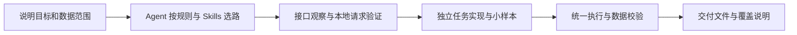

# Spider Workbench

**把数据采集与 Web / JavaScript 逆向，变成 Agent 可以持续推进、验证和交付的项目流程。**

你描述网站、数据范围和交付要求，Agent 在同一个工作区里完成环境部署、接口分析、采集实现、样本校验和结果整理。框架将项目规则、13 个通用 Skills、浏览器工具链、统一运行入口与运行证据组织在一起，让每个任务都有清楚的起点、过程和结果。

[下载当前源码](https://github.com/hygge-pixel/spider-workbench/archive/refs/heads/main.zip) · [English](README.en.md) · [框架架构](docs/ARCHITECTURE.md) · [Skills 说明](docs/框架与Skills说明.md)

## 为什么使用 Spider Workbench？

采集和逆向工作经常需要反复搭环境、找接口、处理分页、恢复进度，再确认数据是否完整。Spider Workbench 把这些工作的共用部分留在框架里，让 Agent 把精力放到当前任务的实现和验证上。

| 框架优势 | 对实际工作的帮助 |
|---|---|
| **用自然语言开始，交给 Agent 部署** | 打开项目、发送提示词，由 Agent 检查环境、安装隔离依赖、下载浏览器并接入 MCP，用户无需逐条执行安装命令。 |
| **13 个通用 Skills，按问题调用** | 覆盖采集选路、请求分析、JS 逆向、参数复现、AST、补环境和证据排查，让 Agent 有可查阅的方法与工具。 |
| **浏览器分析与协议采集衔接** | 需要时借助浏览器观察请求、调试 JS，再验证本地 Python / Node 请求；已验证的协议任务可直接执行，减少重复页面操作。 |
| **统一运行和数据校验** | Task 明确字段、唯一键、数量与结束条件；runner 执行采集并校验结果，让“脚本跑完”和“数据合格”分别可判断。 |
| **保留进度，支持复查** | 任务可保存检查点、原始材料和脱敏证据；支持恢复的采集器可据此续跑，交付前也能检查来源与覆盖范围。 |
| **任务独立，复用有边界** | 新任务直接在 experiments 中实施；用户明确要求沉淀时才注册，已注册能力的 proof 与可运行状态分开管理。 |
| **核心轻量，工具环境隔离** | Python 核心只用标准库；浏览器 Profile、Python 工具环境和 npm 依赖留在项目边界内，换电脑时重新生成本机配置。 |
| **方便维护和协作** | 项目自带规则、分层验收、完整回归、文件清单和 CI，方便交接给另一台电脑的 Agent，也方便审核后续修改。 |

## 安装：打开文件夹，发送提示词

将下载并解压后的项目文件夹作为 **coding Agent 的工作区**打开，然后发送：

> 请阅读 README.md、AGENTS.md 和 docs/INSTALL_WITH_AGENT.md，按文档完成这个项目的部署；已经部署的部分先检查并复用。请自动检查并补齐环境和隔离工具依赖，从 Google 官方 Chrome for Testing 下载部署当天最新 Stable 浏览器，配置项目独立 Profile、Chrome/9222 和 js-reverse MCP，不安装或启用 Cloak。完成离线示例、浏览器连接、MCP 实际调用和完整回归，保留已有任务与配置，最后告诉我实际通过和待处理的项目。已授权部署所需的常规可逆安装、构建与本项目配置调整，请连续推进。

Agent 会按[完整部署工单](docs/INSTALL_WITH_AGENT.md)执行后续步骤。需要能操作本机文件、终端并配置工具的 Agent；普通网页聊天窗口不会仅凭这段话自动部署电脑。完整浏览器流程推荐先在 Windows 上使用；其它系统的支持范围由 Agent 实际检查和报告。电脑上已有 Python/Node 版本不符时，Agent 会保留旧环境并选择或并行安装兼容版本；浏览器下载、连接和宿主加载分别验收，详见[版本与部署说明](docs/RUNTIME_COMPATIBILITY.md)。

## 框架怎样处理一次任务？

浏览器观察、JS 调试、纯算法复现和环境补齐都按当次证据使用。任务已有可用协议和样本时，可跳过重复分析。采集仍通过统一 runner 执行；遇到普通失败先保存进度，再评估已实现且同范围的候选。确认出现验证码时按项目规则保存进度并暂停。

## 部署后怎么用？

继续在同一项目里向 Agent 描述需求，例如：

> 从我提供的网站采集最近 7 天的公开文章，字段包括标题、原文、发布时间、作者和来源链接。先给我 5 条样本，确认后采集指定范围，输出 Excel 和 JSON，说明遗漏和失败，并保留进度。没有对应能力就创建独立任务，不自动注册。

说清入口、范围、时间、字段和输出形式，Agent 就能按项目流程推进。任务最终需要的 Excel、JSON 或其它报告，由具体任务实现并验证；框架保留数据与证据的位置，方便找到结果、排查问题和交接。

| 目录 | 你能在这里找到什么 |
|---|---|
| outputs/ | 本次任务的最终文件、报告与部署验收结果 |
| runs/ | 原始数据、标准化记录、校验结果、检查点和脱敏运行证据 |
| experiments/ | 独立任务实现及其非敏感配置 |
| skills/ | Agent 使用的通用方法、脚本与参考资料 |
| spider_core/ | 执行、路由、校验、浏览器资源和能力管理的共用核心 |

日常任务复用已验收环境，不反复安装或自动升级浏览器。网站需要登录时，在项目独立浏览器中完成；换电脑重新部署工具和本机配置，历史登录态不随源码迁移。更多使用与交付说明见[用户指南](docs/USER_GUIDE.md)。

## 随仓库提供的能力

- **项目规则与多平台入口**：AGENTS.md、CLAUDE.md、GEMINI.md，以及本机 Skill 发现链接。
- **采集与逆向方法**：13 个通用 Skills，涵盖 Web 采集、JS 逆向及相关分析流程。
- **统一任务核心**：Python 标准库 runner、路由、字段和唯一键校验、运行比较、显式注册及证明状态管理。
- **浏览器工具链**：随包 JSReverser MCP 源码、Playwright CDP 诊断及隔离工具安装；Agent 部署时从[官方渠道](https://googlechromelabs.github.io/chrome-for-testing/)获取 Chrome for Testing。
- **维护与交付工具**：离线三条合成示例、完整回归、分发清单、公开发布检查和 GitHub Actions。

## 适用范围

适合使用 coding Agent 开展数据采集、接口分析和 Web / JavaScript 逆向的个人与团队，也适合作为新项目的起点。框架初始不附带具体网站采集器；网站适配、分页、字段语义与完整性需要逐任务验证。工具安装通过，也需要继续验证目标网站的真实业务结果。

源码不携带历史客户数据、账号、Cookie、浏览器 Profile 或个人 Agent 设置。Python、Node、浏览器本体在目标机部署，Agent 账户由用户准备。可选外部应用按需要接入；通用框架不承诺任意网站都能直接采集，也不等同于已经打包好的客户桌面软件。

## 进一步了解

[用户指南](docs/USER_GUIDE.md) · [Agent 部署工单](docs/INSTALL_WITH_AGENT.md) · [浏览器与 MCP](docs/BROWSER_MCP.md) · [开发采集器](docs/COLLECTOR_GUIDE.md) · [架构](docs/ARCHITECTURE.md) · [证据与数据](docs/EVIDENCE.md) · [测试与 CI](docs/TESTING.md) · [排错](docs/TROUBLESHOOTING.md) · [依赖状态](docs/DEPENDENCIES.md)

原创部分使用 [Apache-2.0](LICENSE)；第三方保留原许可证，见 [THIRD_PARTY_NOTICES.md](THIRD_PARTY_NOTICES.md)。[贡献指南](CONTRIBUTING.md) · [安全报告](SECURITY.md) · [版本记录](CHANGELOG.md)
